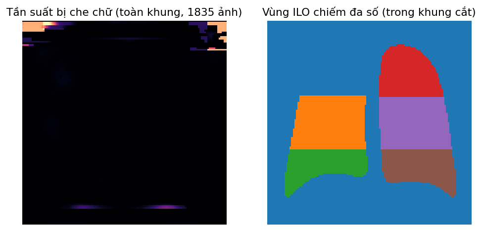
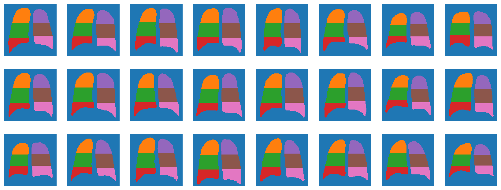

# P0.2 — Tiền xử lý ảnh: che chữ in trên phim → phân đoạn phổi → cắt theo phổi → 6 vùng

Thứ tự theo PAG_V2: (1) đưa ảnh về vuông 1024; (2) phân đoạn phổi sơ bộ (PSPNet torchxrayvision) chỉ để biết chỗ nào là phổi; (3) che chữ in trên phim (burn-in: tên, ngày, ký hiệu L/R) bằng lọc top-hat + ngưỡng sáng + lọc hình dạng, chỉ ở NGOÀI phổi, rồi tô lấp (inpaint Telea); (4) phân đoạn lại trên ảnh đã che; (5) cắt theo khung bao hai phổi + lề 6% (bỏ CenterCrop); (6) chia mỗi phổi thành trên/giữa/dưới ở 1/3 và 2/3 chiều cao → 6 vùng ILO (RU RM RL LU LM LL).

### Kiểm tra chất lượng (1835 ảnh)

| muc | gia_tri |
|---|---|
| Số ảnh | 1835 |
| Ảnh có ít nhất một vùng bị che | 1832 (99.8%) |
| Số vùng chữ / ảnh — trung vị [p5–p95] | 8 [4–14] |
| Diện tích bị che (% ảnh) — trung vị [p95] | 0.92% [1.21%] |
| Ảnh có vùng che chạm phổi (phải = 0) | 16 |
| Phổi phải / trái phân đoạn rỗng (<1% ảnh) | 0 / 0 |
| Khung cắt chiếm (% ảnh) — trung vị [p5–p95] | 59% [45–72%] |
| Vùng có diện tích 0 (không có đặc trưng) | 0 |

_Tệp: `kiem_tra_chat_luong.csv`_

### Diện tích mỗi vùng (% khung cắt 512×512)

| index | mean | 5% | 50% | 95% |
|---|---|---|---|---|
| RU | 6.710 | 5.060 | 6.810 | 7.970 |
| RM | 8.820 | 6.870 | 8.950 | 10.400 |
| RL | 5.890 | 4.380 | 5.940 | 7.220 |
| LU | 6.480 | 5.030 | 6.570 | 7.710 |
| LM | 8.510 | 6.860 | 8.600 | 9.820 |
| LL | 6.170 | 5.180 | 6.180 | 7.170 |

_Tệp: `dien_tich_vung.csv`_

### Bản đồ tổng hợp: nơi bị che chữ và 6 vùng (chỉ mask trung bình, không có ảnh bệnh nhân)

### 24 mask vùng ngẫu nhiên (chỉ mask nhãn vùng, 128×128, không ảnh gốc)

