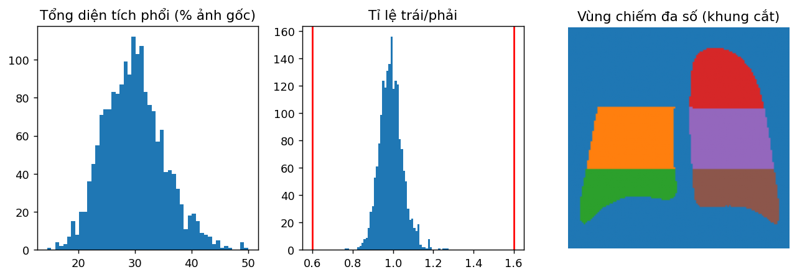

# Xử lý ảnh bản 3 + QA (PG_update §2)

Từ **ảnh gốc** (không dùng bản 224/512 đã lưu): ảnh xám, pad vuông → kiểm tra đảo âm (phân đoạn trên ảnh và ảnh đảo, so độ chắc của mask) → phân đoạn phổi bằng PSPNet torchxrayvision (không dùng mask Set B), giữ thành phần lớn nhất mỗi bên → OCR **chỉ phát hiện** (RapidOCR, mô hình DBNet, không nhận dạng) trên **ảnh gốc** đã pad, bỏ hộp chạm phổi / nghiêng >15° / cao >6% ảnh, tô (inpaint Telea) phần hộp chữ nằm ngoài hộp bao hai phổi → cắt hộp bao hai phổi + lề 5%, pad vuông, resize 512 (không CenterCrop) → **V1**; **V2** = V1 và xóa pixel ngoài mask phổi (nới 1%). Đặc trưng trích SAU khi tô chữ.

### Cờ QA tự động trên 1835 ảnh

| co | so_anh | pct | dev | test |
|---|---|---|---|---|
| dien_tich_phoi_bat_thuong | 9 | 0.5 | 7 | 2 |
| khong_du_2_phoi | 0 | 0.0 | 0 | 0 |
| ti_le_trai_phai_ngoai_0.6_1.6 | 0 | 0.0 | 0 | 0 |
| mask_cham_mep | 15 | 0.8 | 14 | 1 |
| dao_am | 20 | 1.1 | 19 | 1 |
| con_chu | 241 | 13.1 | 206 | 35 |
| ít nhất một cờ | 272 | 14.8 | 237 | 35 |

_Tệp: `co_tu_dong.csv`_

*Diện tích phổi bất thường = tổng diện tích hai phổi (tỉ lệ ảnh gốc) lệch trung vị quá 3 MAD chuẩn hóa (trung vị 29.6%). Không đủ 2 phổi = một bên < 1% ảnh. Mask chạm mép = mask chạm biên ảnh gốc (phổi có thể bị cắt cụt khi chụp). Đảo âm = ảnh đảo (255 − x) cho mask phổi chắc ngang hoặc hơn ảnh gốc (đã tự đảo lại nếu gấp ≥1,5 lần). Còn chữ = OCR chạy lại trên ảnh gốc sau khi tô vẫn thấy hộp chữ trong dải lề của khung cắt (ngoài hộp bao hai phổi). OCR chạy trên ảnh gốc (không phải khung cắt phóng to, nơi nó bắt nhầm xương sườn thành chữ); bỏ hộp chạm phổi, nghiêng >15° hoặc cao >6% ảnh; chỉ tô phần nằm ngoài hộp bao hai phổi (trong trường phổi không có chữ in).*

### Tóm tắt xử lý

| muc | gia_tri |
|---|---|
| Hộp chữ (sau lọc) chồng lên dải lề khung cắt / ảnh — trung bình [p95] | 0.67 [3] |
| Ảnh có tô chữ | 791 (43.1%) |
| Diện tích tô (% khung cắt) — trung vị trong ảnh có tô [p95] | 0.18% [0.37%] |
| Ảnh có hộp OCR chạm phổi (bỏ, không tô — phổi không có chữ in) | 206 |
| Ảnh bị đảo lại (đảo âm theo phân đoạn) | 0 |
| Khung cắt chiếm (% ảnh gốc) — trung vị [p5–p95] | 56% [41–72%] |
| Tỉ lệ trái/phải — trung vị [p5–p95] | 0.99 [0.90–1.09] |
| Vùng có diện tích 0 | 0 |

_Tệp: `tom_tat_xu_ly.csv`_

### QA trực quan

| muc | gia_tri |
|---|---|
| Ảnh trong gói QA trực quan | 315 |
|   trong đó mẫu ngẫu nhiên (dev, phân tầng lô × nhãn) | 50 |
|   trong đó bị đánh cờ | 272 |
| Đã chấm | 315 |
| Mẫu ngẫu nhiên đạt | 48/50 (96%) |
| Cổng QA (≥ 90% mẫu ngẫu nhiên đạt) | ĐẠT |
| zone_missing (không đủ 2 phổi hoặc chấm hỏng) | 0 |

_Tệp: `qa_truc_quan.csv`_

### Kết quả chấm theo nguồn

| ngau_nhien | dat | mot_phan |
|---|---|---|
| False | 257 | 8 |
| True | 48 | 2 |

_Tệp: `ket_qua_cham.csv`_

### Loại lỗi ghi nhận khi chấm (một ảnh có thể nhiều loại)

| loai | so_anh |
|---|---|
| V1 còn ký tự lẻ R/L (không đọc ra thông tin) | 68 |
| Sót chữ cạnh vùng đã tô, không đọc được | 60 |
| Phổi chạm / tràn viền khung (V1 hoặc V2) | 14 |
| Còn chữ đọc được (tên/ngày/mã) | 0 |

_Tệp: `ghi_chu_cham.csv`_

*Không ảnh nào còn chữ đọc được; lỗi chữ còn lại chỉ là ký tự lẻ hoặc mảnh chữ vỡ hạt ở góc/vai, ngoài phổi.*

### Phân bố diện tích, tỉ lệ trái/phải và bản đồ vùng trung bình (không có ảnh bệnh nhân)

